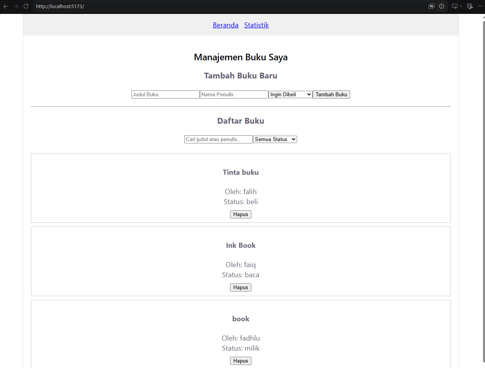
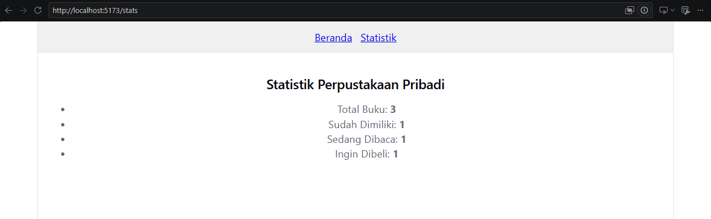
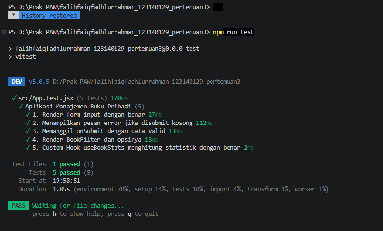

# Aplikasi Manajemen Buku Pribadi

**Identitas:**
- **Nama Lengkap:** Falih Faiq Fadhlurrahman
- **NIM:** 123140129
- **Kelas Praktikum:** Pengembangan Aplikasi Web RB

---

##Deskripsi Aplikasi
**Aplikasi Manajemen Buku Pribadi** adalah aplikasi antarmuka web berbasis React yang dirancang untuk membantu pengguna mengelola katalog buku pribadi secara efisien. Pengguna dapat mencatat buku yang dimiliki, sedang dibaca, atau yang ingin dibeli di masa mendatang.

###Fitur Utama:
- **Manajemen Data (CRUD):** Menambah buku baru, mengedit data buku, dan menghapus buku dari katalog.
- **Pencarian & Filter:** Menyaring daftar buku berdasarkan kriteria status (*Beli*, *Baca*, *Milik*) serta pencarian waktu nyata (*real-time*) berdasarkan judul atau nama penulis.
- **Statistik Otomatis:** Halaman khusus statistik untuk memantau ringkasan total buku berdasarkan kategorinya.
- **Penyimpanan Persisten:** Seluruh data buku tersimpan secara otomatis di `localStorage` browser sehingga data tidak hilang saat halaman di-refresh.
- **Validasi Input & Error Handling:** Mencegah pengiriman form kosong dan menampilkan pesan peringatan visual.

---

##Instruksi Instalasi & Cara Menjalankan

### Prasyarat
- **Node.js** (versi 18.x atau yang lebih baru)
- **npm** (Package Manager)

### Langkah-langkah
1. Masuk ke Direktori Proyek:
   ```bash
   cd falihfaiqfadhlurrahman_123140129_pertemuan3

2. Pasang Seluruh Dependensi:
   ```bash
   npm install
3. Jalankan Server Pengembang (Development Mode):
   ```bash
   npm run dev
4. Jalankan Pengecekan Kode:
   ```bash
   npm run lint
5.Jalankan Unit Testing (Vitest & React Testing Library):
   npm run lint

---

##Fitur React & Teknologi yang Digunakan

* **`useState`** (`BookForm.jsx`, `Home.jsx`)  
  Mengelola *state* lokal seperti nilai input form, teks pencarian (*search term*), dan status filter.
* **`useEffect`** (`useLocalStorage.js`)  
  Menyinkronkan perubahan *state* buku ke dalam `localStorage` secara otomatis setiap kali *state* berubah.
* **Context API** (`BookContext.jsx`)  
  Menyediakan *global state management* untuk data buku dan fungsi pembantunya (`addBook`, `editBook`, `deleteBook`) tanpa *prop drilling*.
* **Custom Hooks** (`useLocalStorage.js`, `useBookStats.js`)  
  * `useLocalStorage`: Mengenkapsulasi logika pembacaan dan penulisan data ke `localStorage`.
  * `useBookStats`: Mengkalkulasi akumulasi jumlah total dan status buku secara efisien menggunakan `useMemo`.
* **React Router** (`App.jsx`)  
  Mengatur navigasi multi-halaman (*Single Page Application*) antara halaman Beranda (`/`) dan Statistik (`/stats`).
* **PropTypes** (Seluruh Komponen)  
  Menjalankan *runtime type checking* pada *props* komponen untuk memastikan validitas tipe data.
* **Vitest & React Testing Library** (`App.test.jsx`)  
  Melakukan pengujian unit (*unit testing*) komponen React dan Custom Hooks secara terisolasi.
* **Oxlint** (`package.json`)  
  *Linter* super cepat berbasis Rust untuk memastikan kerapian dan kebersihan sintaksis kode.

  ---

  ##Screenshot

  Home:
  

  Stats:
  

  Test:
  
