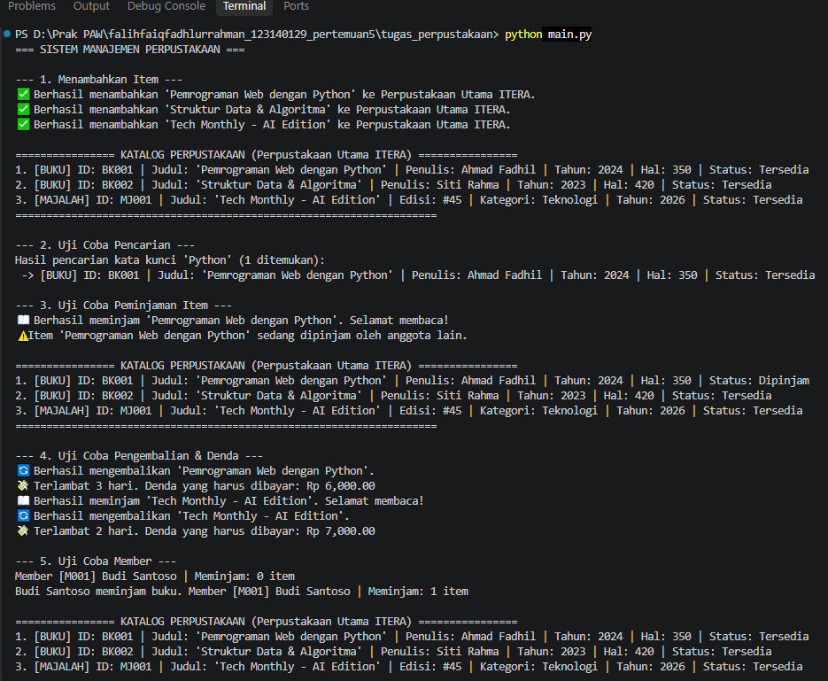

# Sistem Manajemen Perpustakaan

**Identitas Mahasiswa:**
- **Nama Lengkap:** Falih Faiq Fadhlurrahman
- **NIM:** 123140129
- **Kelas Praktikum:** Pengembangan Aplikasi Web RB


## Deskripsi Program
Sistem Manajemen Perpustakaan ini adalah aplikasi berbasis *Command Line Interface* (CLI) yang dibangun murni menggunakan bahasa pemrograman Python. Aplikasi ini memodelkan sistem sirkulasi barang di perpustakaan secara nyata dengan mengadopsi paradigma **Object-Oriented Programming (OOP)**. 

Aplikasi ini dapat mengelola berbagai jenis item perpustakaan (seperti Buku dan Majalah), mencatat peminjaman, memproses pengembalian, serta menghitung denda keterlambatan secara dinamis berdasarkan jenis item.

## Implementasi 4 Pilar OOP
Program ini dirancang dengan mematuhi secara ketat keempat pilar utama Pemrograman Berorientasi Objek. Berikut adalah rincian implementasinya di dalam *source code*:

### 1. Abstraction (Abstraksi)
- **Lokasi:** `library_item.py`
- **Penjelasan:** Diimplementasikan melalui class `LibraryItem` yang mewarisi modul `ABC` (Abstract Base Class). Class ini berperan sebagai "kontrak" (cetak biru) yang tidak bisa diinstansiasi secara langsung. Class ini mewajibkan (melalui dekorator `@abstractmethod`) seluruh subclass-nya untuk menyediakan implementasi dari metode `get_detail()` dan `hitung_denda()`.

### 2. Inheritance (Pewarisan)
- **Lokasi:** `library_item.py`
- **Penjelasan:** Terdapat class `Book` dan `Magazine` yang mewarisi class `LibraryItem`. Dengan pewarisan ini, Buku dan Majalah secara otomatis memiliki atribut dasar seperti `item_id`, `judul`, `tahun_terbit`, serta status `is_dipinjam` tanpa perlu menulis ulang kode tersebut *(DRY - Don't Repeat Yourself)*. Pemanggilan inisialisasi induk dilakukan menggunakan `super().__init__()`.

### 3. Encapsulation (Enkapsulasi / Pembungkusan)
- **Lokasi:** `library_item.py` dan `library.py`
- **Penjelasan:** 
  - Melindungi integritas data menggunakan **Private Access Modifier** (`__`). Contohnya atribut `__koleksi` di dalam class `Library`, serta `__item_id` dan `__judul` di class `LibraryItem`. Data ini terlindungi oleh mekanisme *Name Mangling* dari Python dan tidak bisa diubah langsung dari luar class.
  - Untuk membaca dan memodifikasi nilai yang terproteksi, program ini menggunakan metode *Getter* dan *Setter* yang elegan bergaya *pythonic*, yaitu melalui dekorator `@property` dan `@nama_properti.setter`.

### 4. Polymorphism (Polimorfisme)
- **Lokasi:** `library.py` (pada metode `tampilkan_katalog` dan `kembalikan_item`)
- **Penjelasan:** Ketika objek perpustakaan melakukan perulangan pada `self.__koleksi` (yang berisi campuran objek `Book` dan `Magazine`) lalu memanggil `item.get_detail()` atau `item.hitung_denda()`, Python secara dinamis mengetahui implementasi mana yang harus dieksekusi. Buku akan dieksekusi dengan tarif denda Rp 2.000/hari dan format detail buku, sedangkan Majalah dengan denda Rp 3.500/hari dan format detail majalah, meskipun mereka dipanggil melalui antarmuka perintah yang sama persis.

## Fitur Aplikasi
- **Registrasi Item:** Menambahkan koleksi Buku dan Majalah ke dalam inventaris perpustakaan.
- **Katalog Real-time:** Menampilkan seluruh daftar koleksi beserta status ketersediaannya (Tersedia / Dipinjam).
- **Mesin Pencari:** Mencari item secara spesifik menggunakan kata kunci (berdasarkan Judul atau ID).
- **Sistem Sirkulasi (Peminjaman & Pengembalian):** Validasi otomatis agar item yang sedang dipinjam tidak bisa dipinjam oleh orang lain hingga dikembalikan.
- **Kalkulator Denda:** Penghitungan denda otomatis saat pengembalian telat, yang tarifnya disesuaikan dengan jenis item.


## Panduan Menjalankan Program

### Prasyarat:
- Pastikan komputer Anda telah terinstal **Python versi 3.9** atau yang lebih baru.

### Langkah-langkah Eksekusi:
1. Buka Terminal / Command Prompt / PowerShell.
2. Arahkan direktori terminal ke folder tugas ini:
   ```bash
   cd falihfaiqfadhlurrahman_123140129_pertemuan5/tugas_perpustakaan
   ```
3. Jalankan file eksekutor utama menggunakan perintah:
   ```bash
   python main.py
   ```

## Screenshot

- **Hasil Skrip**

  
